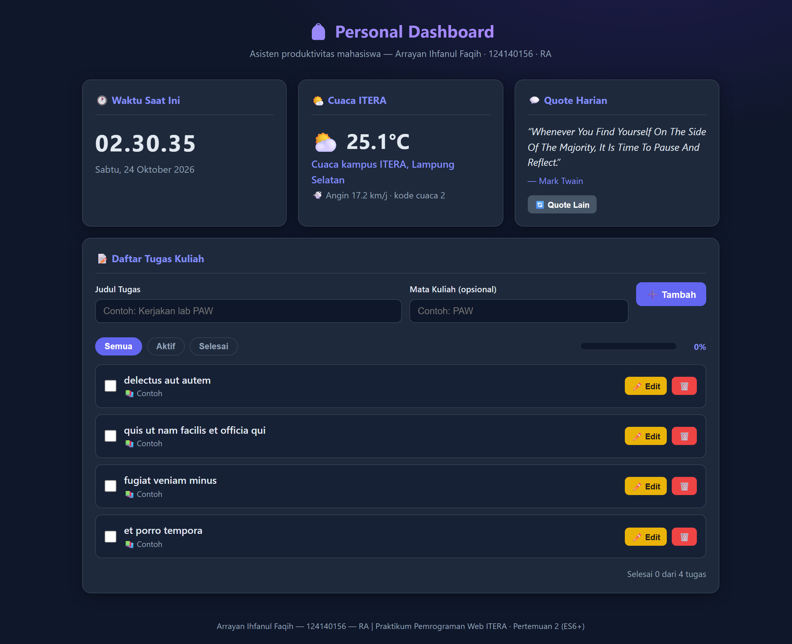
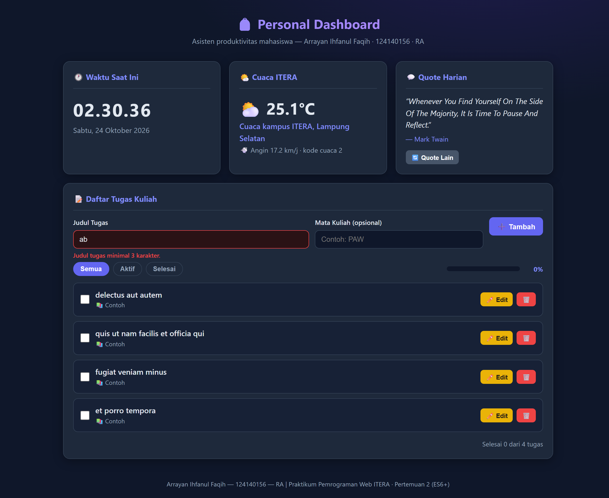
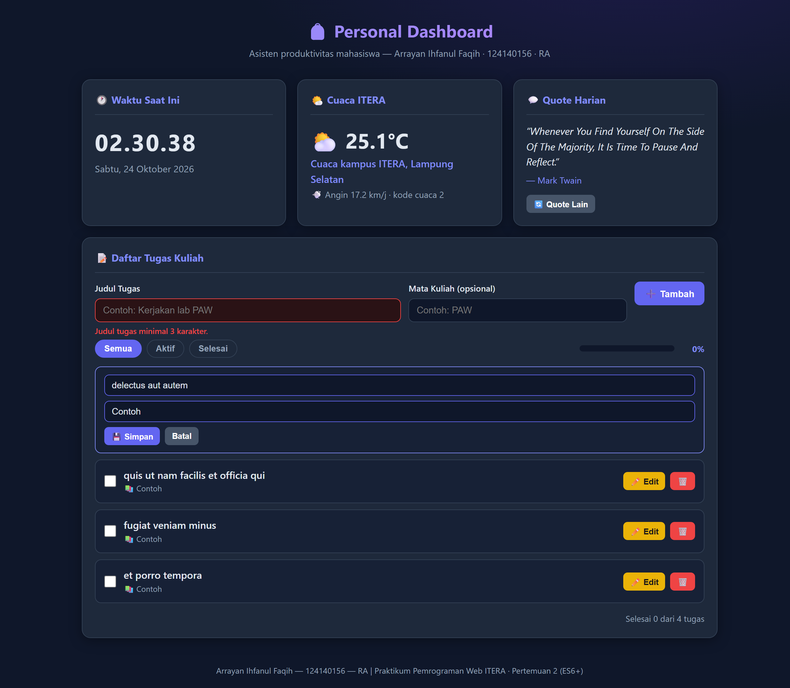
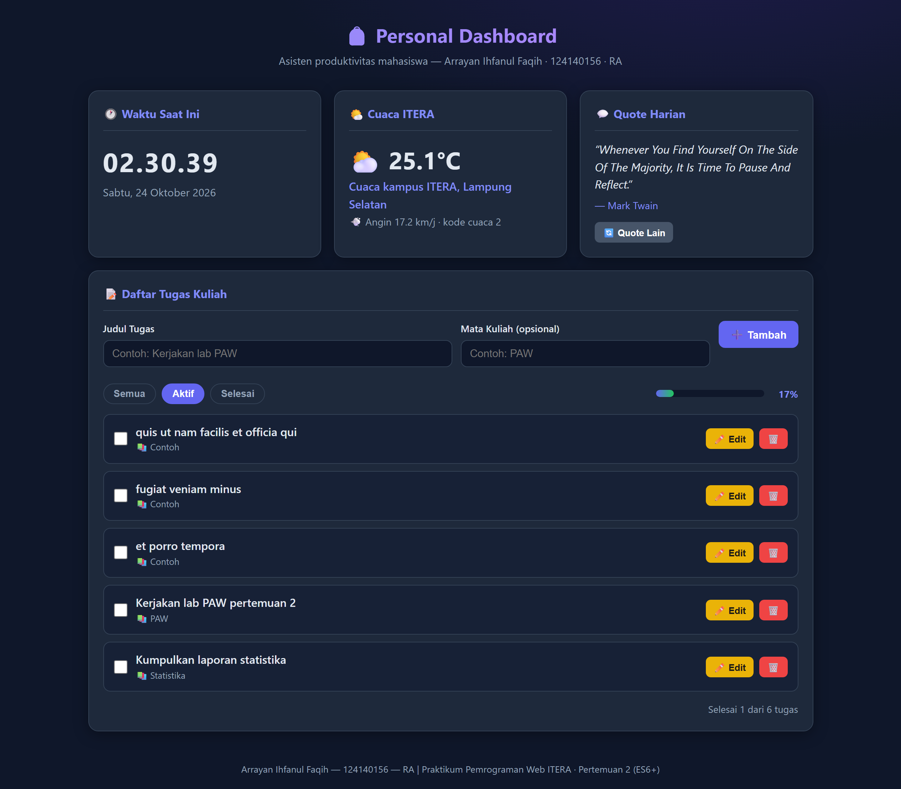
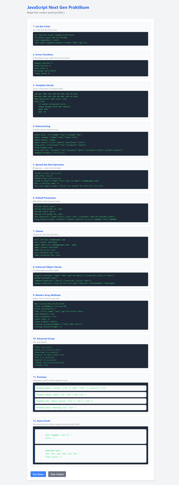

# 🎒 Personal Dashboard — Mahasiswa ITERA

Tugas Praktikum Pemrograman Web — **Pertemuan 2: JavaScript Next Gen (ES6+)**
Studi kasus: Dashboard produktivitas mahasiswa (to-do tugas kuliah + widget cuaca, quote, jam)

---

## 👤 Identitas

| | |
|---|---|
| **Nama** | Arrayan Ihfanul Faqih |
| **NIM** | 124140156 |
| **Kelas Praktikum** | RA |

---

## 📱 Penjelasan Singkat Aplikasi & Fiturnya

**Personal Dashboard** adalah aplikasi web satu halaman berisi widget-widget produktivitas mahasiswa:

1. **📝 Daftar Tugas Kuliah (CRUD lengkap)**
   - Tambah tugas (judul wajib ≥ 3 karakter + mata kuliah opsional) dengan validasi & pesan error merah.
   - **Edit inline** langsung di baris item (input judul + matkul, Simpan/Batal, atau tekan Enter).
   - Hapus tugas, centang selesai, filter (Semua / Aktif / Selesai), progress bar + statistik otomatis.
   - Saat pertama dibuka (storage kosong), aplikasi **seed 4 contoh tugas dari API JSONPlaceholder** (async/await).
2. **🌤️ Cuaca ITERA (real-time)** — suhu, angin, dan kode cuaca kampus ITERA (Lampung Selatan) dari API **Open-Meteo** via `async/await`.
3. **💬 Quote Harian** — kutipan motivasi acak dari API **DummyJSON** + tombol "Quote Lain" (fetch ulang).
4. **🕐 Waktu Saat Ini** — jam real-time (detik berjalan) + tanggal lengkap bahasa Indonesia (`Intl.DateTimeFormat` id-ID).

Semua data tugas **disimpan ke localStorage** sehingga tidak hilang saat halaman di-refresh.

**Teknologi:** HTML5 + CSS3 + JavaScript murni (ES6+), tanpa framework, tanpa API key.

---

## ▶️ Panduan Menjalankan

1. **Clone** repository ini, lalu buka folder `arrayanihfanulfaqih_124140156_pertemuan2/`.
2. **Cara cepat:** klik dua kali `index.html`.
3. **Cara disarankan:** buka folder di VS Code → klik kanan `index.html` → **Open with Live Server**.

> Widget cuaca, quote, dan seed tugas membutuhkan **koneksi internet**. Jika offline, aplikasi tetap berjalan (tugas tersimpan di localStorage tetap tampil; widget menampilkan pesan gagal muat yang ramah).

---

## ✅ Fitur Utama

- [x] Tambah / **edit inline** / hapus tugas (CRUD interaktif)
- [x] Centang selesai + filter (Semua/Aktif/Selesai) + progress bar & statistik
- [x] Validasi form (judul wajib ≥ 3 karakter) + pesan error merah
- [x] localStorage: simpan (`JSON.stringify`), muat (`JSON.parse`), seed dari API saat kosong
- [x] Cuaca real-time Open-Meteo (async/await)
- [x] Quote harian DummyJSON (async/await) + tombol refresh
- [x] Jam & tanggal real-time berbahasa Indonesia
- [x] Tema gelap modern + responsif (desktop & mobile)

---

## 🖼️ Tangkapan Layar

### 1. Tampilan Utama Dashboard
Widget jam + cuaca real-time (Open-Meteo) + quote (DummyJSON) + daftar tugas hasil seed JSONPlaceholder.



### 2. Validasi Error
Judul tugas "ab" (< 3 karakter) ditolak — pesan error merah + border merah, tidak masuk daftar.



### 3. Edit Inline
Mode edit langsung pada baris item: input judul & mata kuliah, tombol Simpan/Batal (Enter juga menyimpan).



### 4. Interaksi Penuh (tambah, centang, filter, progres)
2 tugas baru ditambahkan via form, satu tugas dicentang selesai, filter "Aktif" menyembunyikan tugas selesai, progress bar menunjukkan 17% (1 dari 6).



### 5. Praktikum Modul (Run Demo)
Project latihan `modul/` dijalankan via Live Server (HTTP) — 12 demo ES6+ tampil sekaligus: variabel, arrow functions, template literals, destructuring, spread/rest, default params, classes, object literals, array methods, advanced arrays, promises, dan async/await.



---

## ⚡ Daftar Fitur ES6+ yang Diimplementasikan (dengan baris kode)

Semua nomor baris mengacu pada file **`script.js`** di folder ini.

| Fitur ES6+ | Lokasi (baris) | Bukti implementasi |
|---|---|---|
| **Classes** | `script.js:59`, `script.js:96` | `class TaskItem` (model data tugas) & `class DashboardApp` (state + localStorage + DOM + fetch) |
| **Class method & constructor** | `script.js:71-90` | `constructor()`, `perbarui()`, `ubahStatus()`, `tandaiSelesai()` pada `TaskItem` |
| **Arrow functions (≥3 wajib)** | `script.js:28`, `:35`, `:43`, `:52`, `:361-362`, `:416` | `formatJam`, `formatTanggal`, `ikonCuaca`, `elemen`, `perbarui` (di dalam `mulaiJam`), `tampilkanQuote` |
| **Template literals** | `script.js:226-243`, `:258-263`, `:384-388` | Rendering dinamis item tugas, progress/statistik, dan widget cuaca |
| **Destructuring (parameter)** | `script.js:121-122`, `:156` | `filter(({ judul }) => …)`, `map(({ id, judul, matkul, selesai }) => …)`, `data.map(({ id, title }) => …)` |
| **Destructuring (objek + rename)** | `script.js:382`, `:405` | `const { current_weather: cuaca } = …`, `const { quote, author } = …` |
| **Spread operator (immutable)** | `script.js:170` | `this.tugas = [...this.tugas, item]` (tambah tugas) |
| **Rest/immutable map** | `script.js:178`, `:185`, `:192` | `map()/filter()` mengembalikan array baru saat edit/hapus/toggle |
| **Async/Await** | `script.js:147` (`seedJikaKosong`), `:374` (`fetchCuaca`), `:398` (`fetchQuote`), `:422` (`init`) | `fetch()` + `await`, error handling `try/catch` |
| **let & const** | seluruh file | Tidak ada `var` sama sekali |
| **Default parameters** | `script.js:64,71` | `matkul = ""`, `selesai = false`, `id = null` pada constructor `TaskItem`; `:167` `matkul = ""` |
| **Nullish coalescing `??`** | `script.js:74` | `this.id = id ?? Date.now() + …` |
| **Optional chaining & short-circuit** | `script.js:243`, `:263` | `${t.matkul ? … : ""}`, ternary pada statistik |
| **Method chaining `replaceAll`** | `script.js:228-229` | Escape tanda kutip pada input edit |

**Contoh potongan inti:**

```js
// class + nullish coalescing (script.js:59-74)
class TaskItem {
  constructor(judul, matkul = "", selesai = false, id = null) {
    this.id = id ?? Date.now() + Math.floor(Math.random() * 1000);
    ...
  }
}

// arrow function (script.js:28-31)
const formatJam = (tanggal) =>
  new Intl.DateTimeFormat("id-ID", { hour: "2-digit", minute: "2-digit", second: "2-digit" }).format(tanggal);

// spread immutable (script.js:170)
this.tugas = [...this.tugas, item];

// async/await + destructuring + template literal (script.js:374-388)
async function fetchCuaca() {
  const respons = await fetch(URL_CUACA);
  const { current_weather: cuaca } = await respons.json();
  const { temperature, windspeed, weathercode } = cuaca;
  wadah.innerHTML = `<p class="cuaca-utama">${ikonCuaca(weathercode)} <span class="suhu">${temperature}°C</span></p> ...`;
}
```

---

## 🗄️ Pengelolaan Data localStorage

| Kapan | Aksi |
|---|---|
| Tambah / edit / hapus / toggle | `simpanKeStorage()` → `localStorage.setItem("dashboardTugas", JSON.stringify(this.tugas))` |
| Halaman dibuka | `muatDariStorage()` → `JSON.parse(...)` → dipetakan kembali menjadi instance `TaskItem` |
| Storage kosong pertama kali | `seedJikaKosong()` → ambil contoh tugas dari JSONPlaceholder → simpan |
| Data rusak / bukan array | `try/catch` → diabaikan dengan aman, aplikasi tetap jalan |

---

## 📁 Struktur Folder

```
arrayanihfanulfaqih_124140156_pertemuan2/
├── index.html      # Struktur halaman dashboard
├── style.css       # Styling tema gelap + responsif
├── script.js       # Logika ES6+ (classes, async/await, localStorage)
├── README.md       # Dokumentasi tugas
├── screenshots/    # 5 screenshot (4 dashboard + 1 praktikum modul)
├── scripts/        # Script screenshot otomatis + mini static server
├── test/           # Tes logika otomatis (34 + 56 assertions)
└── modul/          # Project latihan praktikum (project-js-nextgen, 12 demo ES6+)
```

## 🧪 Pengujian

- Tes dashboard (`node test/test-logic.js`, mock DOM/localStorage/fetch): **34/34 lulus** — seed API, CRUD, immutability spread, filter & progres, validasi form, persist localStorage, render widget asinkron.
- Tes modul latihan (`node test/test-modul.mjs`, ES module): **56/56 lulus** — seluruh 12 fungsi demo ES6+ diverifikasi hasilnya.
- Halaman modul diverifikasi berjalan di Chrome nyata melalui server HTTP (`scripts/server-modul.js`) karena ES modules tidak bisa jalan via `file://` (lihat screenshot ke-5).

## 🔗 Repository

https://github.com/Rayann956/pemrograman_web_itera_124140156
