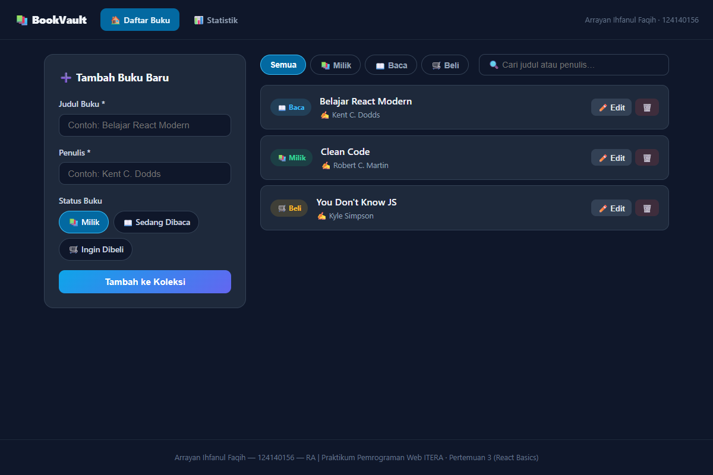
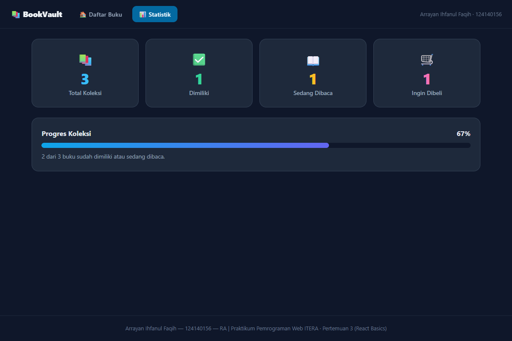

# 📚 BookVault — Aplikasi Manajemen Buku Pribadi

Tugas Praktikum Pemrograman Web — **Pertemuan 3: React Basics**

Aplikasi manajemen buku pribadi untuk mencatat buku yang dimiliki, sedang dibaca, atau ingin dibeli. Dibangun dengan React (Vite), React Router, Context API, custom hooks, PropTypes, dan lokalStorage — dengan 7 unit test (Vitest + React Testing Library).

---

## 👤 Identitas

| | |
|---|---|
| **Nama** | Arrayan Ihfanul Faqih |
| **NIM** | 124140156 |
| **Kelas Praktikum** | RA |

---

## 📱 Penjelasan Singkat & Fitur

**BookVault** adalah aplikasi satu halaman (multi-route) untuk mengelola koleksi buku pribadi:

1. **Tambah Buku** — form input judul, penulis, dan status (📚 Milik / 📖 Baca / 🛒 Beli) dengan validasi kolom wajib + feedback visual merah.
2. **Daftar Buku** — render daftar dengan badge status, edit inline, dan hapus.
3. **Filter & Pencarian** — filter berdasarkan status dan cari berdasarkan judul/penulis.
4. **Halaman Statistik** — ringkasan jumlah buku per status + progres koleksi.
5. **Penyimpanan Lokal** — data tersimpan di `localStorage`, tidak hilang saat refresh.
6. **Navigasi Multi-Halaman** — React Router (Daftar Buku ↔ Statistik).

**Teknologi:** React 19 (Vite), React Router DOM, Context API, Custom Hooks, PropTypes, localStorage, Vitest + React Testing Library, tanpa API key.

---

## 🛠️ Instalasi & Cara Menjalankan

```bash
# 1. Masuk ke folder project
cd arrayanihfanulfaqih_124140156_pertemuan3

# 2. Install dependensi
npm install

# 3. Jalankan development server
npm run dev
```

Buka `http://localhost:5173` di browser.

### Script Tersedia

| Script | Keterangan |
|---|---|
| `npm run dev` | Jalankan server development (Vite) |
| `npm run build` | Build produksi ke folder `dist/` |
| `npm test` | Jalankan seluruh unit test (Vitest) |

---

## 🖼️ Tangkapan Layar

### 1. Halaman Utama — Daftar Buku
Form tambah, filter/pencarian, dan daftar buku hasil seed awal.



### 2. Halaman Statistik
Ringkasan jumlah buku per status dan progres koleksi.



---

## ⚡ Fitur React yang Digunakan

| Fitur React | Lokasi | Keterangan |
|---|---|---|
| **Functional Component + Hooks** | Semua komponen (`src/components/*`, `src/pages/*`) | Tanpa class component |
| **`useState`** | `BookContext.jsx`, `BookForm.jsx`, `BookList.jsx` | State form, filter, mode edit |
| **`useEffect`** | `BookContext.jsx` (sync localStorage), `Stats.jsx` (judul tab) | Lifecycle & side effect |
| **Context API** | `src/context/BookContext.jsx` | State global buku (CRUD + filter + search) |
| **Custom Hook** ×2 | `src/hooks/useLocalStorage.js`, `src/hooks/useBookStats.js` | Persist localStorage + hitung statistik (useMemo) |
| **React Router** | `src/App.jsx` | Navigasi `/` dan `/stats` via `BrowserRouter`, `Routes`, `Route`, `NavLink`, `Navigate` |
| **PropTypes** | Semua komponen reusable | Type checking props (BookForm, BookItem, BookList, BookFilter, Navbar, BookProvider) |
| **Controlled Component** | `BookForm.jsx` | Input judul/penulis/status dikontrol state React |
| **Conditional Rendering** | `BookList.jsx` | Tampilkan pesan kosong jika daftar kosong |
| **Render List + Key** | `BookList.jsx` | `.map()` dengan `key={b.id}` |

---

## 🧪 Testing

7 unit test (Vitest + React Testing Library + jsdom):

1. Validasi form input kosong → pesan error muncul
2. Tambah buku baru → muncul di daftar + form direset
3. Filter status → menyembunyikan buku status lain
4. Pencarian → menyaring berdasarkan judul/penulis
5. Edit & hapus buku
6. Statistik halaman `/stats` menampilkan jumlah per status
7. Navigasi React Router antar halaman

Jalankan:

```bash
npm test
```

Hasil: **7/7 lulus**. Screenshot hasil eksekusi test dapat dihasilkan dengan menjalankan `npm run dev` dan mencapture halaman melalui browser.

---

## 📁 Struktur Folder

```
arrayanihfanulfaqih_124140156_pertemuan3/
├── index.html
├── vite.config.js
├── package.json
├── src/
│   ├── App.jsx
│   ├── App.css
│   ├── main.jsx
│   ├── components/
│   │   ├── BookForm/   (BookForm.jsx, BookForm.css)
│   │   ├── BookList/   (BookList.jsx, BookList.css)
│   │   ├── BookFilter/ (BookFilter.jsx, BookFilter.css)
│   │   └── Navbar/     (Navbar.jsx, Navbar.css)
│   ├── pages/
│   │   ├── Home/   (Home.jsx, Home.css)
│   │   └── Stats/  (Stats.jsx, Stats.css)
│   ├── hooks/
│   │   ├── useLocalStorage.js
│   │   └── useBookStats.js
│   ├── context/
│   │   └── BookContext.jsx
│   └── test/
│       ├── setup.js
│       └── App.test.jsx
├── screenshots/
│   ├── 1-dashboard-utama.png
│   └── 2-statistik.png
└── scripts/
    └── screenshot.cjs
```

---

## 🔗 Repository

https://github.com/Rayann956/pemrograman_web_itera_124140156

Folder tugas: `arrayanihfanulfaqih_124140156_pertemuan3/`
